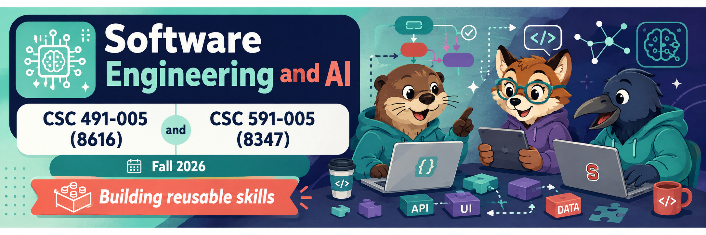
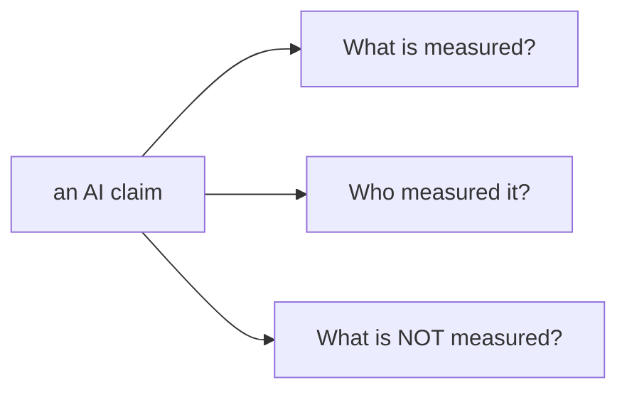
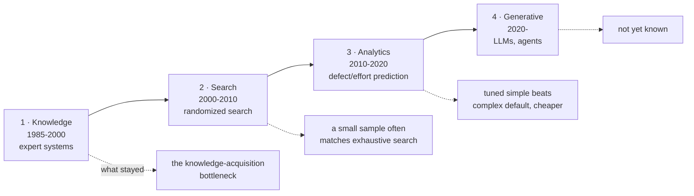
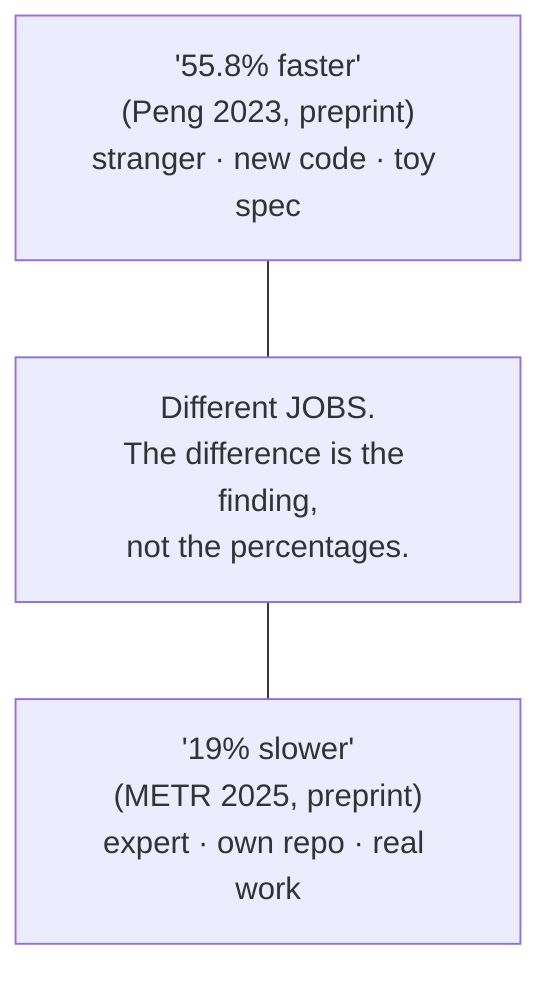
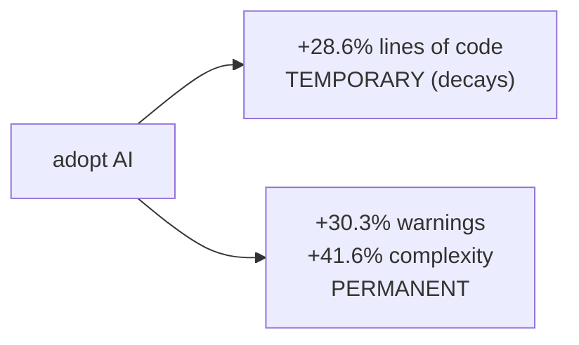
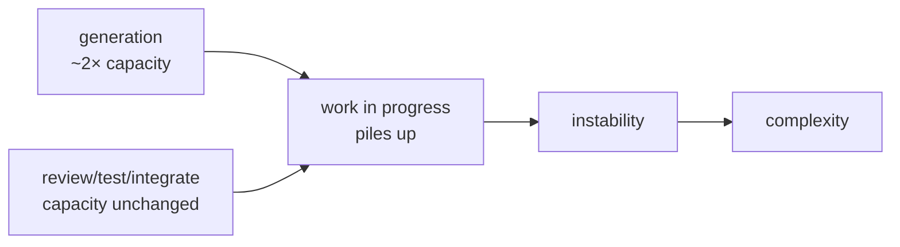

  
  
  
  
  
  
  
  

<h1 align="center">:cyclone: CSC491/591: SE for AI  NC State, Fall '26</h1>

# All you need is evidence

Companion to [All you need](allyouneed.md). That lecture gave the
three paradigms. This one gives the rule for believing any of them.

A **demonstration** is an existence proof: a result happened once, for
one person, on a day they chose. Engineering needs **distributions,
not examples.** So meet every AI claim with three questions:

## Four waves — each shrank to a component

"AI for SE" arrived four times. Each completed wave was announced big
and ended as a small, reusable part.

Waves 2 and 3 *are this course*: small samples match exhaustive
search; a tuned simple learner usually beats a complex default at
lower cost. **Repeat that test on any LLM before you buy it.** In
every completed wave the measured result was smaller than the
announcement, and the useful part became a component.

## The two numbers everyone quotes — neither peer-reviewed

Study 1 measured a stranger writing new code to a known spec. Study 2
measured an expert changing a codebase they already knew. AI helps
those jobs by different amounts. **That difference is the result** —
the two percentages are not facts to quote, and both are preprints.

## The peer-reviewed results: speed yes, quality no

Across seven peer-reviewed studies the pattern is one sentence:

> **Speed is measured, and usually positive. Quality is almost never
> measured. The one study that measured it found the damage *stays*
> after the speed stops.**

Learn **He et al. 2026** (806 repos, difference-in-differences):

You get the speed for one quarter. You keep the complexity for the
life of the repo. That is a loan — **technical debt**.

## Individual up, organization flat (none peer-reviewed — say so)

DORA 2025 (~5,000): throughput turned positive in 2025, but
**instability stayed negative**; "fail fast, fix fast" was not
supported. MIT NANDA: 95% of GenAI pilots showed no financial return
(52 interviews, self-reported). Faros telemetry (>10,000 devs): tasks
+21%, merged PRs +98%, **org delivery metrics unchanged.**

The mechanism is **queueing**:

Generation roughly doubled; review, test, and integration did not. The
surplus becomes work-in-progress → instability → complexity. The
bottleneck moved to the thing you did not speed up: **collecting and
checking outcomes** — review, test, integration
([All you need](allyouneed.md)).

## Sources

Every citation links to a DOI, PDF, or report so you can check it.
The full wave-by-wave history (with its own links) is in
[N12 §2](https://github.com/txt/se26f/blob/main/docs/lect/n12.md) and
[productive.md](https://github.com/txt/se26f/blob/main/docs/lect/productive.md).

Framing:

- *The AI effect* (four-wave stock-take), IEEE Software 2020
  — [doi:10.1109/MS.2020.2987666](https://doi.org/10.1109/MS.2020.2987666)
- Compton & Jansen, ripple-down rules, 1990
  — [doi:10.1016/S1042-8143(05)80017-2](https://doi.org/10.1016/S1042-8143(05)80017-2)

The two quoted numbers (both preprints):

- Peng et al., *Impact of AI on developer productivity*, 2023
  — [arXiv:2302.06590](https://arxiv.org/abs/2302.06590)
- METR, *Measuring the impact of early-2025 AI on developer
  productivity*, 2025 — [arXiv:2507.09089](https://arxiv.org/abs/2507.09089)

Peer-reviewed:

- Cui et al., Management Science 2026
  — [doi:10.1287/mnsc.2025.00535](https://doi.org/10.1287/mnsc.2025.00535)
- Daniotti et al., Science 391:831, 2026
  — [doi:10.1126/science.adz9311](https://doi.org/10.1126/science.adz9311)
- He et al., MSR 2026
  — [doi:10.1145/3793302.3793349](https://doi.org/10.1145/3793302.3793349)
- Paradis et al., ICSE-SEIP 2025
  — [doi:10.1109/ICSE-SEIP66354.2025.00060](https://doi.org/10.1109/ICSE-SEIP66354.2025.00060)
- Mohamed et al. (quality review), TOSEM 2026
  — [doi:10.1145/3809494](https://doi.org/10.1145/3809494)
- Butler et al., ICSE-SEIP 2025
  — [doi:10.1109/ICSE-SEIP66354.2025.00034](https://doi.org/10.1109/ICSE-SEIP66354.2025.00034)
- Kumar et al. (agents in industry), ASE 2025
  — [doi:10.1109/ASE63991.2025.00043](https://doi.org/10.1109/ASE63991.2025.00043)

Not peer-reviewed (cite with that fact attached):

- DORA 2025 report — [dora.dev/dora-report-2025](https://dora.dev/dora-report-2025/)
- MIT Project NANDA, 2025, and Faros AI telemetry, 2025 — vendor /
  self-reported; no DOI. Treat as weak evidence.
