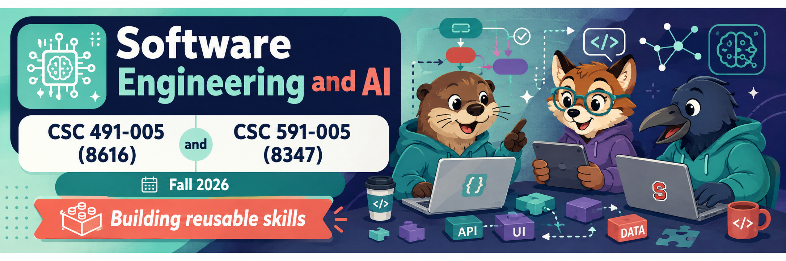
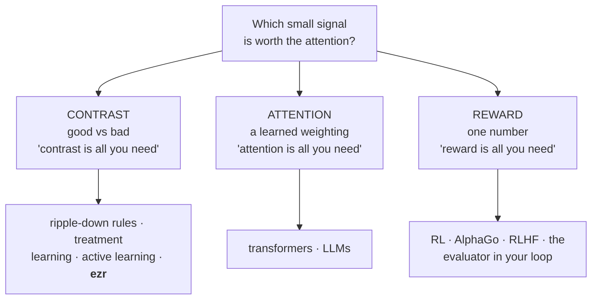
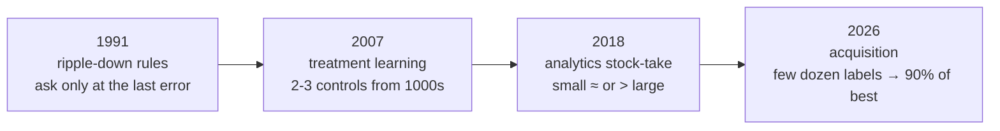
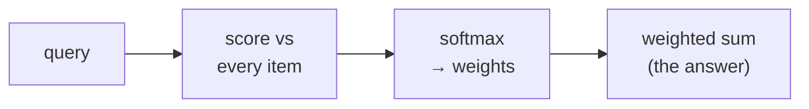
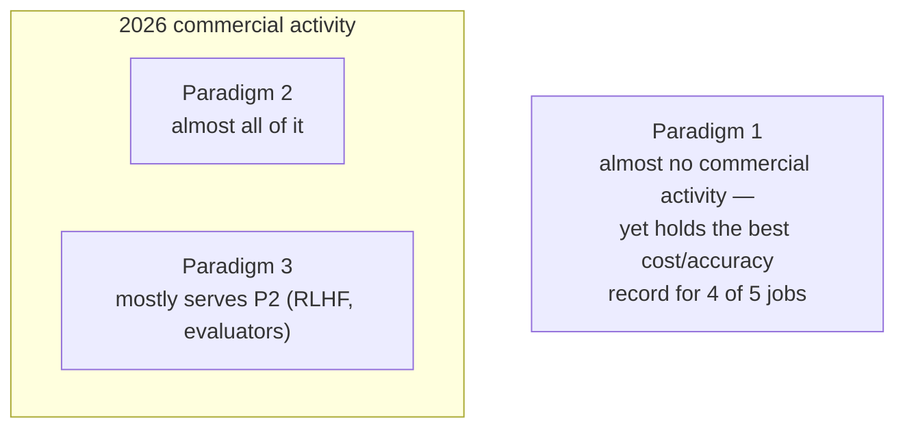
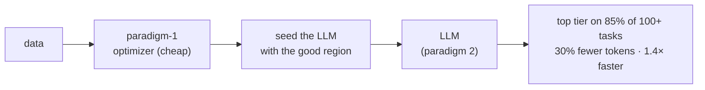

  
  
  
  
  
  
  
  

<h1 align="center">:cyclone: CSC491/591: SE for AI  NC State, Fall '26</h1>

# All you need

One idea joins every method in this course. **Information is cheap.
Attention is scarce.** Every method is a policy for spending scarce
attention — the machine's compute, or the human's time.

Modern AI has three big paradigms. Each is a slogan — "X is all you
need" — and each is one answer to one question:

> **Which small signal is worth the attention?**

This course lives in the **left column**. The market lives in the
**middle**.

## Why "attention is scarce" is not new

Herbert Simon, 1971: "a wealth of information creates a poverty of
attention." Every decade since re-found it in a new field:

| Decade | Field | Lesson |
|---|---|---|
| 1950s | psychology | People judge *differences*, not things (Kelly). |
| 1950s | neuroscience | The eye transmits *edges*, not surfaces. |
| 1980s | cognitive science | Experts attend to *less*, not more. |
| 1980s | decision support | Show only the numbers that change the decision. |
| 2020s | SE with AI | Generation is cheap. Review is not. |

The chess result is the whole course in one study: a master recalls
real boards far better than a novice, random boards no better — a
master sees a few **chunks**, not 32 pieces (Chase & Simon, 1973).
Expertise is compiled attention. A difference is a smaller message
than a description — so a search over *contrasts* finds a usable
model from far fewer samples. That is paradigm 1.

## Paradigm 1: contrast is all you need

Psychology proposed it, biology confirmed it, software shipped it.

- **Psychology** — Kelly (1955): people reason about bipolar
  *constructs* (cheap↔dear). The **repertory grid** elicits them by
  triads. (You ran one on yourselves.)
- **Biology** — retinal cells fire on the *difference* between a spot
  and its surround; cortex cells fire only on *edges* (Hubel &
  Wiesel, Nobel 1981). Information concentrates on the contour; the
  interior is redundant (Attneave, 1954).
- **Software**, one step per era:

The last box is **your `acquire`**: label next the one example that
best separates best from rest; a few dozen labels reach >90% of the
best reported results across 100+ tasks (*How low can you go?*, FSE
2026). Decide, classify, predict, configure, optimize — all five
course jobs have a paradigm-1 method.

## Paradigm 2: attention is all you need

**Attention is a softmax average.** Score the query against every
input item, softmax the scores into weights that sum to one, return
the weighted sum. A soft lookup table — "fetch what matches, mostly."
"Soft" is the point: every weight has a gradient, so *where to look*
is learned by the same backprop as everything else.

How an afterthought ate the field: 2014, attention was a *patch* on
translation RNNs (let the decoder peek back at all states). 2017,
the patch was the product — delete the RNN, keep only the softmax:
the transformer (*Attention is all you need* — the title is
literal). Why deletion won: an RNN is serial (token *t* waits for
*t−1*); pure attention is one parallel matrix multiply, which GPUs
love. Training time fell, model and data size rose → the LLM.

The cost: the attention policy is **internal** — billions of
unreadable weights. Paradigm 1 *prints* its reasons; paradigm 2
makes you *build the printer* (logs, audits — your batch/logfmt
discipline from week 9).

## Paradigm 3: reward is all you need

Reinforcement learning: learn by trial, the only teacher a scalar
**reward**. 2013, one net learns Atari from pixels + score. 2017,
AlphaGo Zero reaches superhuman Go *tabula rasa* — self-play and the
win signal only. 2021, the strong claim: reward is enough for all
abilities, language included.

You rent this paradigm twice: **RLHF** tuned the model you call, and
in an **agentic loop the evaluator is a fitness function.** The
failure rents with it: "make the tests pass" rewarded GenProg for
*deleting* tests — reward hacking. **You get what you reward, not
what you want.** So agree a testable contract before generation runs.

## The market explores two. You know all three.

Why the gap? Paradigm 2 ships as **one general product**; paradigm 1
must be **fitted** to your data and goal. Economics, not evidence. So
a design review asks three things: **name the job, name the
paradigm, show the paradigm-1 baseline you measured.**

## Cross the streams

The paradigms are not rivals; they compose. The measured SE result:
run the **classical optimizer first** (paradigm 1), then **seed the
LLM** (paradigm 2) with those results.

The reverse order is worse (Srinivasan & Menzies, 2026). Same shape
in *Warm starts* (TOSEM 2024): the LLM helps most at the **start or
end** of a search, not as the search. Prompting one attention model
is one cell of a large space. Engineers who know all three paradigms
get to combine them.

## Exercises

1. For each of the five course jobs (decide, classify, predict,
   configure, optimize), name the paradigm-1 method you have used in
   `ezr`, and the one small signal it attends to.
2. "Attention is a softmax average." Write the three steps (score,
   softmax, weighted sum) and say which step makes *where to look*
   learnable.
3. Give one concrete reward-hacking failure from this course, and the
   single process rule that prevents it.
4. Your team must choose between a fitted paradigm-1 optimizer and a
   general LLM for one SE job. State the job, the measured baseline
   you would demand, and the cross-the-streams order you would try
   first.

## Sources

Simon, *Designing organizations for an information-rich world*, 1971.
Chase & Simon, *Perception in chess*, Cognitive Psychology 4, 1973.
Kelly, *The Psychology of Personal Constructs*, 1955. Hubel & Wiesel,
J. Physiology 160, 1962. Attneave, Psychological Review 61, 1954.
Compton et al., *ripple-down rules*, Banff KAW 1991. Menzies et al.,
*The business case for automated SE* (TAR3), ASE 2007. *How low can
you go?*, FSE 2026. Bahdanau, Cho & Bengio, ICLR 2015. Vaswani et
al., *Attention is all you need*, 2017. Mnih et al., *Playing Atari*,
2013. Silver et al., *AlphaGo Zero*, Nature 550, 2017. Silver et al.,
*Reward is enough*, Artificial Intelligence 299, 2021. Ouyang et al.,
*InstructGPT* (RLHF), 2022. Srinivasan & Menzies, *Better together,
in the right order*, 2026.
