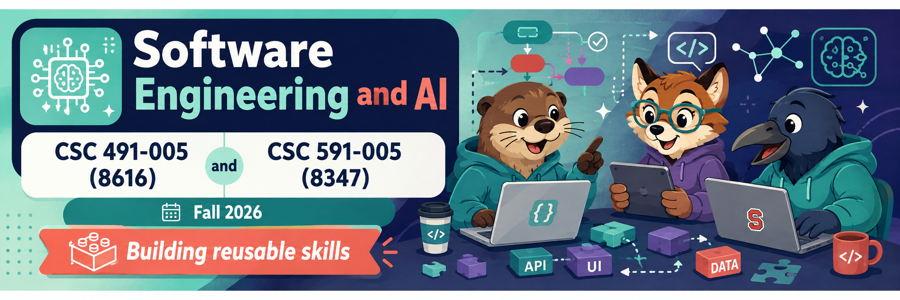
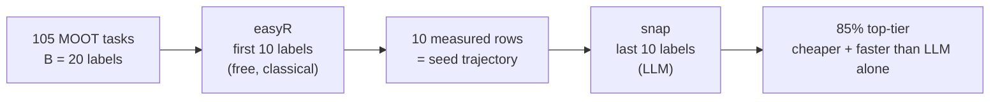

  
  
  
  
  
  
  
  

<h1 align="center">:cyclone: CSC491/591: SE for AI  NC State, Fall '26</h1>

# w10: lecture notes + exam questions

Four ideas. Classical first, LLM second, in that order. The four
classic optimizers are one loop with different mutators. The Pareto
frontier is smaller than we taught. And the whole course restated:
everything is the same `table`, one trick swapped per job.

## Better together — classical first, LLM second

The tool talk was *Better Together, in the Right Order* (Srinivasan &
Menzies, 2026). Same frame as the whole course: **options are cheap,
outcomes are expensive.** A config is free to name; measuring how it
runs is not (worst MySQL setup is 480× slower than best; x264 on 11
params = 1500+ hours). The budget is **B = 20 labels** — priced from a
real grant: one RA, a few students, a few LLM runs ≈ $400 ≈ 20
measurable rows. Land near the best having measured only 20.

"LLM for optimization" means **three** different things, by how much
search the LLM owns:

- **none** — plain classical search (our `easyR`).
- **LLM-as-helper** — classical drives, calls the LLM for hints (LLM
  first, classical second).
- **LLM-as-optimizer** — the LLM *is* the search (OPRO, `snap`).

Two building blocks:

- **`easyR`** — no LLM. Measure 4 rows, split best/rest, score every
  unmeasured row by *near best, far from rest*, label the winner,
  repeat. Costs nothing; 37 ms; **71% top-tier**. Strong baseline.
- **`snap`** — LLM is the whole optimizer. Show it the sorted
  trajectory (best last — models attend to the prompt's end), it
  returns two JSON configs, each snapped to the nearest unmeasured
  row. **Collision tracking**: if a guess lands on an already-tried
  row, the LLM is circling — add that spot to a "taken" list and tell
  it to look elsewhere. 158 s; **75% top-tier**.

The new move is **`snap2`**: split the 20-label budget in half.
`easyR` spends the first 10 (free) to pick good rows; those become
`snap`'s starting trajectory for the last 10. Classical first, LLM
finishes. **85% top-tier** — beats `snap` by 11 points, 30% fewer
tokens, 1.4× faster, half the cost. The reverse order (LLM first,
classical cleans up) is strictly worse.

**When to use which:** `easyR` when cost or speed matters (it is ~3000×
faster for a Δ only ~3 points lower); `snap2` when quality is worth
paying for. `snap2` is **insurance** — on a bad `easyR` start it
rescued one demo set from Δ=56% to 98%.

## The four classic optimizers are one loop

GA, differential evolution, simulated annealing, local search — same
race, same interface, differ only in *how they mutate* and *what they
mutate*.

- **GA** — tournament-select two good rows, crossover, mutate. Mutation
  rate ≤5% (too much mutation wipes the last generation's lessons — a
  sun too close, cosmic rays erase every gene). On a 4-column set you
  must mutate *something*. Heuristic: mutating a cell with no known old
  value → use the column mean. Sample numerics from a Gaussian
  **capped at ±3 sd** so floats don't blow up into 10⁻¹⁴ garbage.
- **Differential evolution** — for each row, pick 3 others, extrapolate
  `a + (b − c)`; respects cross-column correlation. Tiny populations
  work (≈10× the number of variables, or just cheat with 20–30).
- **Local search (1+1)** — *p* of the time mutate at random; *1−p* of
  the time freeze every dim but one and sweep it min→max in steps.
  Skiing: stop trying every direction, pick one and run down it.
- **Simulated annealing** — accept a *worse* solution with Boltzmann
  probability; high temperature jumps out of local minima, cooling
  stops the jumps. Temperature normalized by step/budget (step 50 of
  100 → 0.5).

The point: once they share one `table` interface, you collect them all
and race them. The differences are mutation details, not architecture.

## The Pareto recant

Confession: for years, optimize = explore the whole Pareto frontier
("the church of the frontier"). The benchmark that taught it — **DTLZ**
(Deb's artificial suite: tune X and Y counts, dial in holes, concave
vs convex fronts) — turned out **too narrow**. Concave-vs-convex does
not capture real-world variability. MOOT (real data) has shapes DTLZ
never showed.

Two 2026 results broke the habit:

- **Tao Chen** (Birmingham): best solutions live in **1–2 tiny regions**
  of the trade-off balloon. Spreading effort over the whole front is
  waste.
- **Kishan, "zoom, don't wander"** (SSBSE 2026): a plain greedy search
  *toward* the frontier matches wandering the whole frontier, again and
  again.

So run a **tree over the frontier** (zoom to the good region), not a
spread across it. And the usual objection — "greedy gives one point, no
choice of options" — is answered by `acquire`: its best/rest sample
feeds a tiny decision tree, so you still get an **options space**, the
one selling feature Pareto was supposed to own.

## Everything is the same table

The closing restatement. One `table`, one distance; swap one trick per
job:

- **classify** → report the **mode** of the nearest leaf.
- **regress** → report the **mean/median** of the nearest leaf.
- **anomaly** → flag rows **far** from every leaf (certification
  envelope).
- **optimize** → walk toward the leaf nearest **heaven**.

Classic AI algorithms (kNN, k-means, Naive Bayes, random forests) all
collapse to a few lines once they run on this shared structure — and on
narrow real data (points cluster in thin bands, "galaxy superclusters")
the cheap version keeps up with SOTA.

## Exam questions

*Each question stands alone — no lecture context assumed.*

**Q1. Budget and neuro-symbolic order**

a) What is a "budget" in an optimization study? How does the budget
a standard optimizer spends differ from the kind of budget this
course cares about?

b) A symbolic method (a classical optimizer) and a neural method (an
LLM) can be combined in different orders. Give an example of
symbolic-then-neural, of neural-then-symbolic, and of
symbolic-neural-symbolic. Which order has been found to work best —
and why is it a mistake to call such neuro-symbolic combinations new?

**Q2. The cheap learner vs the paid one**

a) `easyR` — the active-learning `acquire` system from this course —
finds near-best configurations using **no LLM**. Give its loop: how it
picks the next row to label.

b) A cheap classical learner can run thousands of times faster than an
LLM-seeded one, for only a few points less quality. When do you pick
the cheap learner, when is paying for the LLM worth it, and what is
meant by calling the LLM pass "insurance"?

**Q3. Four optimizers, one loop**

a) Give the loop of a **genetic algorithm**: how it makes the next
generation from the current one.

b) Give the mutation rule of **differential evolution** — how it
proposes a new candidate from existing rows.

c) **Simulated annealing** sometimes accepts a *worse* solution, and
**local search** sometimes freezes all but one variable. Say what each
of those moves buys you.

d) GA, DE, SA, and local search can all be run in one race behind one
interface. Name what is **shared** across all four and the two things
that actually **differ** between them.

**Q4. The Pareto recant**

a) One artificial benchmark taught a generation to "explore the whole
Pareto frontier." Name the limitation of that benchmark and the
real-data alternative that exposed it.

b) If the good solutions sit in just 1–2 small regions of the frontier,
how should you search it? And how does `acquire` still hand the user a
range of options rather than a single point?

## Answers

*A practice bank. These are not the exam.*

**A1.** (a) A budget is the number of expensive evaluations you are
allowed to spend. A standard optimizer (GA, DE, SA) spends a
**generous** budget — thousands of fitness evaluations, because it
assumes evaluation is cheap. This course spends an **austere** budget —
a few dozen **labels** (B ≈ 20–50) — because the thing being measured
(an outcome: a run, a build, a human rating) is expensive. Options are
cheap, outcomes are not. (b) **Symbolic→neural (S→N):** run a classical
optimizer first, then seed an LLM with its good region (`snap2`).
**Neural→symbolic (N→S):** have the LLM propose a starting population,
then let a classical learner finish. **Symbolic-neural-symbolic
(S→N→S):** classical seed → LLM proposal → classical cleanup/snap back
to real rows. **S→N won** (classical-first beats LLM-first). It is a
mistake to call these new: neuro-symbolic combinations, mixed and
matched many ways, predate 2026 — only the specific cost/accuracy
numbers are new, not the idea.

**A2.** (a) Measure 4 random rows, split into best and rest; score
every unmeasured row by *close to best, far from rest*; label the
best-scoring row and fold it into best (evict best's worst to rest if
best overflows); repeat until the label budget runs out. (b) Pick the
cheap classical learner when **cost or speed** matters — it is far
faster for a quality only slightly lower. Pay for the LLM when
**quality is worth the money**. "Insurance" means: on a *bad* start the
cheap learner can stall, and the LLM pass rescues it (one demo went from
Δ=56% to 98%) — you pay a premium that mostly does little, but it
guarantees you reach a good result.

**A3.** (a) Tournament-select two good rows, crossover them, mutate the
child (rate ≤5%; cap Gaussian draws at ±3 sd); repeat for a generation,
then iterate. (b) For each row, pick 3 other rows at random and
extrapolate: `a + (b − c)` — this respects cross-column correlation.
(c) Accepting a worse solution (SA, with Boltzmann probability that
falls as temperature cools) lets the search **jump out of local
minima** early, then settle. Freezing all but one variable (local
search) turns the step into a cheap **deterministic sweep** of a single
dimension — you stop wasting moves on directions that don't help. (d)
**Shared:** one `table`, one distance, one race behind one interface —
same architecture. **Differ:** *how* they mutate (crossover vs `a+(b−c)`
vs freeze-and-sweep vs accept-worse) and *what/how much* they mutate.

**A4.** (a) **DTLZ** is artificial and **too narrow** — its
concave-vs-convex fronts don't capture real-world variability; **MOOT**
(real data) showed shapes DTLZ never produced. (b) The good solutions
live in 1–2 regions, so **zoom**: run a tree *toward* that region rather
than spreading effort across the whole front (greedy-toward-frontier
matches wandering it). `acquire` still gives options because its
best/rest sample feeds a small decision tree, so the user sees a range
of good-to-bad choices, not just one point.
