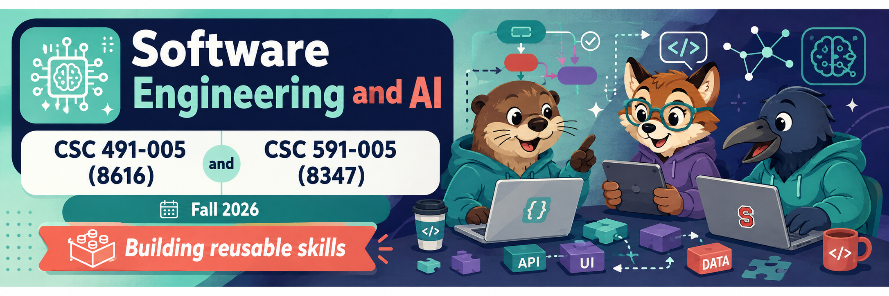

<p align="center">
  <a href="https://github.com/txt/seai26f/blob/main/README.md"></a>
  <a href="https://github.com/txt/seai26f/blob/main/docs/lect/policies.md"></a>
  <a href="#"></a>
  <a href="https://moodle-courses2527.wolfware.ncsu.edu/course/view.php?id=11951&bp=s"></a>
  <a href="https://moodle-courses2527.wolfware.ncsu.edu/course/view.php?id=13665&bp=sfroge"></a>
  <a href="https://ncsu.hosted.panopto.com/Panopto/Pages/Sessions/List.aspx#folderID=a8560b36-2071-4a70-8c3a-b4a4017e9ff5"></a>
  <a href="https://discord.gg/uQgTnGsfR"></a>
  <a href="https://github.com/txt/seai26f/blob/main/LICENSE.md"></a></p>
<h1 align="center">:cyclone: CSC491/591: SE for AI <br>NC State, Fall '26</h1>


# w8: lecture notes + exam questions

Acquisition again: the sway3 acquire protocol, leakage, the
bitter lesson, and the table as a Swiss-army knife (kNN,
anomaly detection, Bayes, k-means).

**One correction before anything else.** The in-class acquire
walkthrough (best/rest tables, centroid distance, Welford ±1
updates) was the NEW algorithm ("ezr2"). It is simpler, and you
get it for reference. The code you were given, and **the exam,
use the older sway3 `acquire`/`acquireR`**: recursive fastmap
with 4 labels per level, keep the best 0.66, restart while
budget remains. The next two sections are the exam version.

## The exam version: sway3 acquire

Both the week-2 fastmap and sway3 recurse the same way: find
two distant poles, sort the pool by closeness to the better
pole, keep the near part, recurse on it. The settings differ:

| Setting | fastmap (wk 2-3) | sway3 acquire (exam) |
|---|---|---|
| labels per level | 2 | 4 |
| cut between poles | 0.5 (keep half) | 0.66 (keep best 2/3) |
| leaf, budget left | stop | restart at the top |

Why 4 and 0.66? Experiment only: a large Monte Carlo sweep
found (0.66, 4) beat (0.5, 2). Gentler culls waste fewer good
rows; more labels per level steady the poles. Why restart?
Budget math: each level discards a third, so a descent bottoms
out after 5-6 cuts having spent maybe 20-ish labels of a
50-label budget. So `acquireR` wraps `acquire`:

```
acquireR(rows, budget):
    while budget > 0:
        budget = acquire(rows, budget)  # one descent, 4 labels/level
    return best labeled row
```

Each restart draws its poles only from rows labelled SO FAR, so
every descent inherits everything paid for, and the second
descent is sharper than the first. In the code: `keepf=0.66`,
`more=4`; the loop also stops if a whole sweep labels nothing
new (a rare debug case). See gloss5 (`acquire`, `restart`,
`budget`) and the glossary's "sway" entry.

## The big loop (same for any model)

Start with unlabeled rows. Shuffle. Split train/test. Learn a
model from train (the previous section). The model sorts the
TEST set using x values only — this is a guess, and costs no
labels. Then label just the top `check` rows of that sorted
list (code: 5; the whiteboard used 3 to keep the picture
small), re-sort those few by their true y, and return the
first. Worked example:

```
1  A B C D E F ... N            # unlabeled rows
2  D N L E B K | A F M I C H    # shuffled, then split
3  (D N L E B K) --> model      # train
         model --> A F M I C H  # apply to test
4  A F M I C H --sort(guess)--> H M F A C I
5  label top-3 {H,M,F}, sort by real y --> F M H
6  return F                     # the car we recommend
```

When asked to "print the acquire result", the first item is
step 6's row: it should be a pretty good car. One run proves
nothing (stochastic, real-world data): 20 repeats, then stats.

## The great anti-pattern: leakage

When writing an active learner, always review the code looking
for decisions made using information not present at that point
in the protocol. E.g. distance calculations using the mu/sd of
train+test data is leakage; what is NOT leakage is normalizing
test values using the mu/sd seen in training. Note that
"labelling" is different: a label applies ground truth, the
view from an omniscient all-knowing being, so ground-truth
labelling can use all the data.

Two places this bites. The model that crosses from train to
test is a tree, and every fork in it tests an x value, never a
y: the tree is the f in y = f(x), and paying for a y on the way
down defeats the point of a predictor. And the classic bug seen
in class: sorting the test set by its TRUE y values gives
"fantastic" results and silently blows the label count to
~550. If your first acquire pick looks too good, count your
labels.

## The bitter lesson, and against it

Sutton 2019 (~800 words, worth reading): clever small tricks
keep losing to general methods plus exponentially more compute.
timm: it is wonderfully wrong — that is an OWNER's argument,
not a steward's. Exponential resource use does not scale to
everyone (data-center water; ~$580B in committed compute
against ~$200-300B projected AI revenue to 2030). The middle
road is neuro-symbolic: an LLM above for critique and guidance,
cheap symbolic inference below. That is your project: N MOOT
data sets, ten skills, built three ways (no hints / timm's
toolkit / scikit-learn) under three build strategies (all at
once / one at a time with reuse / one at a time with revision)
— nine systems. Preliminary grad-student result: all nine score
about the same; code size, runtime, construction effort and
maintainability (tokens needed to maintain it) differ wildly.
Judge systems on those, not just accuracy. See also:
[this talk](https://www.youtube.com/watch?v=ntO2eQ2iu6o&t=384s).

## The table is the Swiss-army knife

Once TABLE exists (adds, mids, distances), classic algorithms
collapse to a few lines:

- **kNN**: two lines — push the k nearest neighbours' y values
  into a NUM, read the median. Use k=3-4, not 1, to dodge
  noise; kernels (uniform, triangular) are a detail.
- **Anomaly detection**: find your nearest cluster; if you are
  far from its centroid, raise a flag. The fix for the
  crater-model failure, where a model answered confidently far
  outside its data.
- **Naive Bayes**: one table per class plus an argmax
  (`most like`): ~15 lines.
- **k-means** (played in class with students as rows): pick k
  rows as centroids; everyone points at their nearest centroid;
  the mid of each mass is the next centroid; repeat. k-means++
  is 26 pages of mathematics whose algorithm is "pick the next
  centroid with probability proportional to distance squared".
- **Welford with inc=-1**: rows can be SUBTRACTED from a
  table's running stats, so moving rows between best and rest
  is O(1) — roughly 500× faster model updates than active
  learners that rebuild tree ensembles.

Moral (Cohen): benchmark the sophisticated against the
seemingly naive; these straw men do not burn. People will not
do this by default: in the symmetry/Lego studies, subjects
chose additive fixes over subtractive ones ~1200:300.
Complexity sells; simplicity does not need a server room.

## Exam questions

**Q1. The acquire protocol (exam version)**

a) List, in order, the six steps of the sway3 acquire test
protocol, from "a pile of unlabeled rows" to "the row we
recommend". Mark the ONE step where test-set labels are spent.

b) After the model sorts the test set, the order is
`H M F A C I`. With check=3, the true y values are F=2, M=5,
H=9 (lower is better). Which row is returned? How many test
labels were spent?

**Q2. sway3 vs fastmap**

a) Give the two settings that differ between week-2 fastmap
descent and the exam's `acquire`, with their values, and one
sentence on where those values came from.

b) Budget 50, keep 0.66, 4 labels per level, pool of 100 rows,
minimum pool ~6. Show why one descent cannot spend the budget,
and say what `acquireR` does about it — including where each
restart gets its poles.

**Q3. Leakage**

a) Your distance function normalizes columns using the mu/sd
of the whole table, train and test together. Leakage or not,
and why? Same question for normalizing a test row with the
mu/sd seen in training, and for the `label` function reading
any row's true y.

b) A classmate's acquire returns a suspiciously perfect car,
and their label counter reads ~550 on a budget of 50. What did
they sort by, and why does that not count as learning?

## Answers

*A practice bank. These are not the exam.*

**A1.** Shuffle; split train/test; learn a model from train
(sway3 descent); model sorts test by x only (no labels); label
the top `check` rows and re-sort them by true y — the ONLY
test-set labeling; return the first. For (b): label {H, M, F},
true order F(2) M(5) H(9), return F; three labels spent.

**A2.** Labels per level 2→4; cut 0.5→0.66 (keep the best two
thirds); from a Monte Carlo sweep, not theory. For (b): one
descent is a lopsided tree. Each level labels up to 4 rows,
sorts the pool by the poles, keeps the best 2/3 and never
looks at the rest:

```
labelled |
so far   | one descent
---------+---------------------------------------------
    4    | 100 rows ............... label 4
         | |-- worst 34 ........... ignored
    8    | `-- best 66 ............ label 4
         |     |-- worst 22 ....... ignored
   12    |     `-- best 44 ........ label 4
         |         |-- worst 15 ... ignored
   16    |         `-- best 29 .... label 4
         |             |-- worst 10  ignored
   20    |             `-- best 19 . label 4
         |                 |-- worst 6  ignored
   24    |                 `-- best 13 ........ label 4
         |                     |-- worst 5 .... ignored
   24    |                     `-- best 8 ..... pool too small: stop
```

Six or seven levels at 4 labels ≈ 24-28 labels, so a budget of
50 cannot be spent in one descent. `acquireR` loops `acquire`
while budget remains, each restart descending from the top
with poles drawn only from the rows labelled so far, so
paid-for knowledge carries over and later descents are
sharper.

**A3.** Train+test mu/sd in the distance calculation is
leakage: a decision made with information not available at that
point in the protocol. Normalizing a test row with training's
mu/sd is NOT leakage: the model may view new data through the
statistics it already owns. The `label` function is also not
leakage: labelling applies ground truth, the omniscient view,
and may use all the data — but every call is counted against
the budget. For (b): they sorted the test set by true y — that
is looking up the answer key, and its cost is the hundreds of
labels the counter shows; the guess step must rank by x alone.
