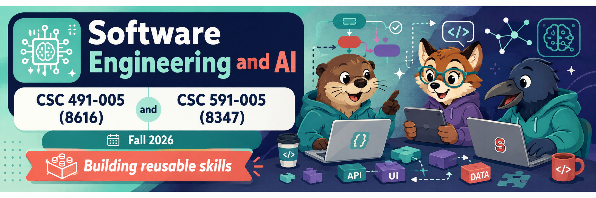

  
  
  
  
  
  
  
  

<h1 align="center">:cyclone: CSC491/591: SE for AI  NC State, Fall '26</h1>

# w9: lecture notes + exam questions

Five ideas. The clustering zoo is one trick. Hyperparameter
optimization hides under every learner. Small samples now beat big
compute for regression too, not just optimization. Build for agents
with logfmt. Then a talk: SWAY.

## Clustering: one trick, many names

- **DBSCAN**: sort cells by density; walk neighbour-pointers out from
  the densest. One sort plus pointers.
- **mini-batch k-means**: first k rows are the centroids; later rows
  join the nearest and update stats (Welford); move centroids every
  ~1000 rows. Tiny memory, huge data.
- **agglomerative**: link nearest neighbours into pairs, then nearest
  pairs, then quads — a tree grows bottom-up.
- **spectral**: build an affinity graph, cluster on its Laplacian's
  eigenvectors (connectivity, not variance). Related to PCA, not the
  same.

Our **two-remote-poles trick is a non-parametric PCA** — cheap
projection by distance to pivots — so we already own a version of
this family. And the charts that say "shape Y wants algorithm X"? None
of those rules hold. Experiment on *this* data instead.

> **Errata — spectral clustering.** In class it was called "PCA:
> find the directions of greatest variance." That was wrong. PCA
> looks at how the *features* vary together. Spectral clustering
> instead builds a *graph* of which points are near which (an
> affinity matrix) and uses that graph's eigenvectors — which is
> exactly why it finds oddly-shaped clusters PCA cannot. The cheap
> PCA we *do* own is the two-poles trick: project by distance to two
> distant points. That is **FastMap, and FastMap is a non-parametric
> PCA** (formally, a Nyström approximation of classical MDS, which
> equals PCA — Platt, 2005). Bottom line: **SWAY/fastmap ≈ PCA;
> spectral clustering ≠ PCA.**

## Anomaly detection = a certification envelope

A clustering tree puts each row in a chunk. Per chunk, store the
centroid and the mean distance of its rows to it. On a new row: find
its chunk; if it sits >~2 sd past that mean, flag it — "closest I
have, but you are weird."

So **every learner should ship a certification envelope**: a cheap
record of what it was trained on, built from two poles plus a mean/sd
per region. Then it can refuse to answer outside its data. (The crater
model, with no envelope, confidently mis-rated the Columbia strike.)

## Hyperparameter optimization

Every learner is a bag of magic numbers (a decision tree alone has a
wall of split/depth/stop knobs). Your conclusions ride on those
numbers. Off the shelf, C5.0 is a loser; tuned, it wins.

So HPO is itself a learning problem. Its **x = the config options**,
its **y = the learner's score** — and that y is expensive (you must
build and run a learner to get it). The course move: **use the cheap
active learner to optimize the expensive one.** Caveat: configuring
the configurer gains nothing past ~two layers.

Watch the numbers you ship. The `0.664` cut came from a 100,000-trial
sweep over MOOT — so it over-fits MOOT — but it ran in two hours on a
laptop. The neural version runs until the heat death of the universe.
That cheapness is the open-science case against "full neural, always."

## The weekend result: small samples beat big compute

- **LuaJIT**: ~8× over the best optimizing Python.
- **Tab / rmeans** (~10 lines): bin each numeric column, store the
  median y per bin; for a test row, average the bins, nudge by sd. 20
  columns = 20 votes on y.
- Rivals: **LightGBM** (SOTA symbolic) and a **TabPFN-class** model
  (SOTA neuro).

On dozens of data sets (log-scale runtime, so gaps are orders of
magnitude):

- **Regression**: rmeans on **45 labels** tracks rmeans on **all
  rows**. Small samples are enough. Except for a few diverse sets,
  every method lands on top of every other.
- **Classification** (Naive Bayes): within ~5% of the rest — ok, not
  great — and neuro runs orders of magnitude slower (sometimes times
  out) for no win. Harder because >2 classes shatter the space, and a
  small sample can miss a class.

The frame: if the mission is only to **rank** (find rows near the
best), a weak predictor is plenty — optimization needs "less-than,"
not a good "equals." Sensational, and hard to publish: no one wants to
hear about simplicity.

## logfmt: build for agents, not just humans

In the age of agents, anything useful you build gets picked up and
rerun by something else. So emit **logfmt** — dense `key=value`
records, "less than JSON" — as the native output, and `| pretty` it
only for human eyes. Same data, one pipe apart.

The rule is the dialog/model split restated: **anything generated in
your code must also be available in batch** — reachable by an agent,
fast, no GUI. Norman named the *gulf of execution* between human and
program; agents add a **gulf of evaluation** — can the agent read what
you made? Build to close it.

## Talk: SWAY

**SWAY** — a baseline optimizer that *is* this subject, two years
early. Under the hood it is week-2 **fastmap**: split a big pool by
distance between decisions, keep one **representative** per region
(our poles), prune the loser, recurse — no model runs wasted on
mutation. It is the ancestor of `acquire`: same recursion, minus the
label budget. The move that made it work is the move the whole course
is built on — drop **binary domination** (which gives fat,
useless fronts once goals multiply) for plain **numeric distance**.
Binary/constrained spaces (Linux product lines: 6888 features, <4 of
10,000 random configs valid) break plain fastmap, so SWAY seeds from a
**SAT solver** or a random descent down the feature tree. And Tao
Chen's result — best solutions live in **1–2 small regions** of the
trade-off balloon — is why we run a tree over the frontier instead of
spreading effort across all of it. (The GALE aside: a *broken* mutator
improved results once generation-1 was bigger; "we called it a
baseline to soothe reviewers — it was a better algorithm.")

Moral: the fastmap you wrote in week 2 is the engine under a "baseline"
optimizer and a tiny regressor beating the state of the art.
Simplicity scales; it just does not sell.

## Exam questions

**Q1. The clustering zoo**

a) Name the one idea shared by DBSCAN, mini-batch k-means, and our
fastmap poles.

b) Is spectral clustering the same as "PCA then cluster"? Say what
spectral actually uses, and which of our tricks really is a
non-parametric PCA.

**Q2. Anomaly detection + HPO**

a) Describe the cheap certification envelope a learner should ship,
and the test it runs on a new row before trusting itself.

b) C5.0 is a loser off the shelf and a winner after tuning. Explain
HPO as a learning problem — its x, its y, why y is expensive, and the
course move that makes it affordable.

**Q3. SWAY**

a) Give the two ways SWAY is the same as week-2 fastmap, and the one
way `acquire` extends it.

b) SWAY replaced binary domination with numeric distance. Say what
goes wrong with binary domination as the number of goals grows, and
why Tao Chen's "1–2 regions" result means we run a tree over the
frontier rather than spreading effort across it.

**Q4. logfmt and agents**

a) Give the logfmt discipline — its format and the `| pretty` move —
and the one rule it serves about batch availability.

b) Norman named the gulf of execution. Name the gulf the age of
agents adds, and what it asks of your output.

## Answers

*A practice bank. These are not the exam.*

**A1.** (a) They all split by distance/density and keep statistics on
regions — one sort plus centroid bookkeeping. (b) No: spectral
clusters on the eigenvectors of an affinity graph's Laplacian
(connectivity), not on variance directions, so it is related to but
not the same as PCA. The real non-parametric PCA is our
two-remote-poles / fastmap projection.

**A2.** (a) Per region, store its centroid and the mean (and sd)
distance of its rows to it — a tiny record from two poles. On a new
row: find its region; if it is >~2 sd past that mean, flag it rather
than answer. (b) HPO's x = config options, y = the learner's score; y
is expensive because measuring it means building and running a learner.
The move: use the cheap few-label active learner to optimize the
expensive one — gaining nothing past ~two configure-layers.

**A3.** (a) Same: recursive split by distance between distant poles,
and keep one representative/better region per level. `acquire` extends
it by spending a label budget (and restarting while budget remains).
(b) As goals grow, candidates stop dominating each other on *all*
goals, so the non-dominated front swells into a thick, uninformative
band. Numeric distance ranks cleanly instead. And since the good
solutions cluster in 1–2 regions, a tree reaches those regions
directly, while spreading effort over the whole balloon is waste.

**A4.** (a) Emit dense `key=value` logfmt as the native output, and
`| pretty` it only for humans — same data, one pipe apart — so an
agent can consume everything in batch with no GUI. (b) The **gulf of
evaluation**: can the agent read what you produced? It asks that your
output be machine-parseable, not only human-pretty.

